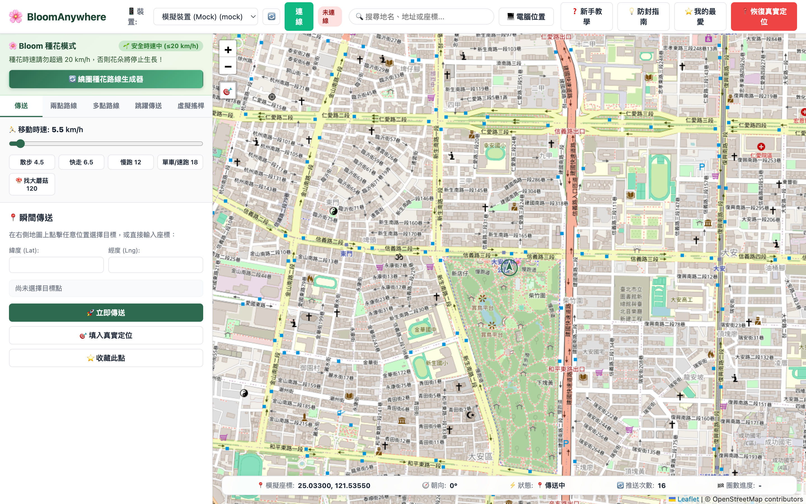
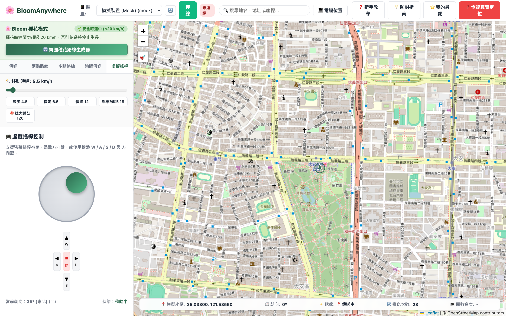
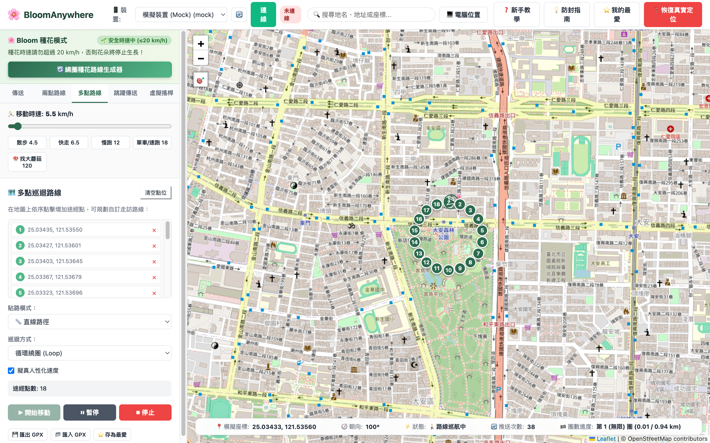
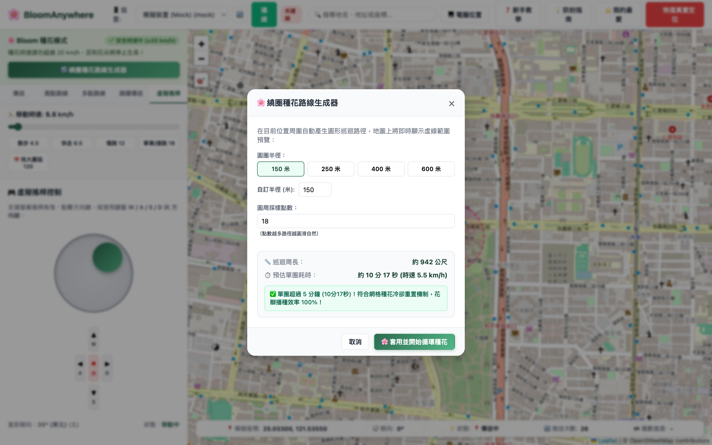
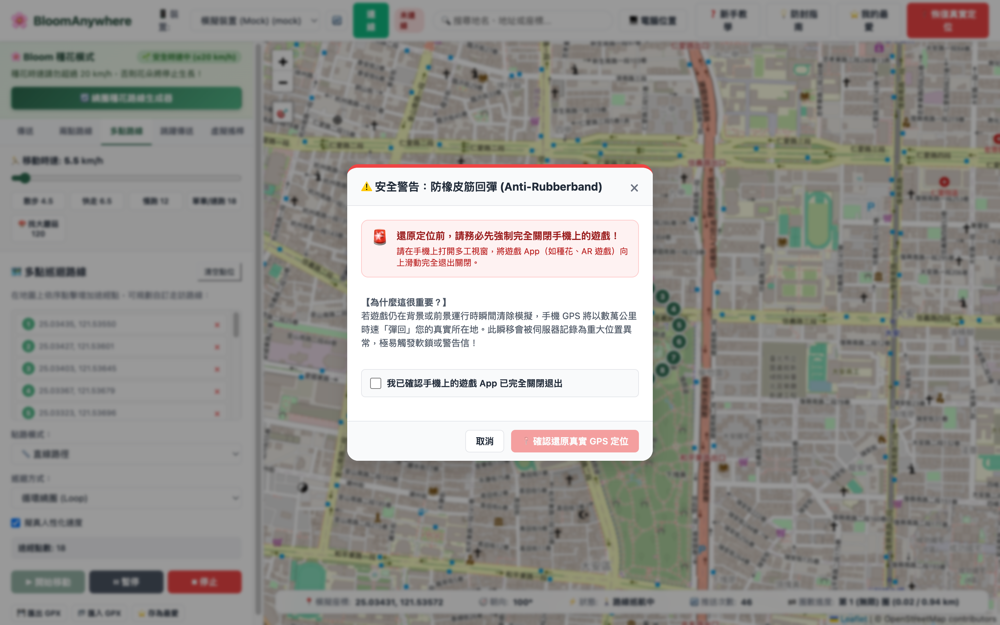

# BloomAnywhere 🌸

跨平台（macOS / Windows / Linux）現代化 GPS 虛擬定位工具與路徑巡航伺服器，**純 Rust 原生打造**。

專為 **Bloom 種花模式** 深度打造，亦支援通用地理測試與 GPX 巡航。內建輕量化 Web 地圖介面（免安裝肥大桌面框架，支援電腦瀏覽器或同區網手機無線遙控）。

---

## 📸 介面預覽

| 主介面與即時冷卻計算 | 虛擬搖桿與鍵盤控制 | 繞圈種花路線生成器 (Bloom 特化) |
| :---: | :---: | :---: |
|  |  |  |

| 繞圈種花設定與 5 分鐘冷卻計算 | 恢復真實 GPS 定位防回彈安全狀態 |
| :---: | :---: |
|  |  |

---

## 🛡️ 飛人安全手冊與防封禁實戰指南（必讀！）

各類地理 AR 遊戲擁有精密的行為遙測與防作弊演算法。若未理解底層機制，極易觸發**軟鎖 (Softban)** 或**帳號處分**。本工具內建多重防護機制，使用時請務必遵守以下五大守則：

### 1. 🚶 步數 (Pedometer) vs GPS (定位) 雙軌機制解密
* **核心機制**：
  * **GPS 虛擬定位**：負責在地圖上移動、播種花朵（消耗花瓣）、促使巨花盛開、以及偵測周遭大蘑菇與探險花苗。
  * **手機動態感應器 (Apple 健康 / CoreMotion / Google Fit)**：負責**花苗成長孵化步數**、**隊伍好感度步數**、與**每日行走統計**。
* **致命陷阱**：
  若帳號在 1 小時內 GPS 瞬移或巡航了 10 公里（種了數千朵花），但 Apple 健康 / Google Fit 回報的實體步數增加為 `0 步`，伺服器能輕易進行數據交叉比對標記為外掛！
* **防封解法**：
  1. **實體搖步器（擺步神器）**：巡航種花時，將手機放置於擺步機上自動搖晃，使感應器步數與 GPS 移動同步增長。
  2. **手持微晃**：使用虛擬搖桿或短程巡邏時，將手機拿在手中自然晃動。
  3. **健康 App 同步**：搭配支援 Apple Health / Health Connect 的計步裝置（如 Apple Watch）確保步數與定位里程合理匹配。

---

### 2. 🚨 絕對杜絕「橡皮筋回彈 (Rubberbanding)」
* **什麼是橡皮筋回彈？**
  當您將手機傳送至異地，在**遊戲仍於前景或背景運行的狀態下**，突然拔掉傳輸線、電腦休眠、或直接點擊「還原真實定位」，iOS CoreLocation 會瞬間跳回您在真實所在地的座標！
  這會導致伺服器在 0.1 秒內測得超音速瞬移，是飛人被官方偵測標記的**第一大死因**。
* **黃金防護法則**：
  > ⚠️ **在拔除傳輸線、中斷連線、或點擊介面「恢復真實定位」之前，務必先將手機上的遊戲 App 強制完全滑掉退出（從多工畫面向上滑掉完全關閉）！**
  本工具介面已全面加入「防橡皮筋安全確認視窗」，請務必依指引確認遊戲已退出。

---

### 3. ⏳ 嚴格遵守冷卻時間表 (Cooldown Rules)
* **冷卻判定準則**：
  **「單純傳送」本身不會觸發懲罰，傳送後「立刻進行需要伺服器寫入的遊戲互動動作」才會觸發軟鎖！**
* **會觸發冷卻記錄的動作**：
  * 加入大蘑菇戰鬥、採摘花苗、領取探險成果等具有伺服器寫入記錄之互動。
* **不會觸發冷卻的動作**：
  在地圖上縮放瀏覽、查看背包、培育或整理隊伍夥伴、領取任務/成就獎勵。
* **社群實測距離-冷卻對照表**：

| 跳躍距離 | 建議冷卻時間 | 跳躍距離 | 建議冷卻時間 |
| :--- | :--- | :--- | :--- |
| **1 km** | 30 秒 | **40 km** | 22 分鐘 |
| **5 km** | 2 分鐘 | **100 km** | 30 分鐘 |
| **10 km** | 7 分鐘 | **250 km** | 45 分鐘 |
| **20 km** | 12 分鐘 | **500 km** | 65 分鐘 |
| **30 km** | 18 分鐘 | **≥ 1300 km** | **120 分鐘 (上限)** |

> 💡 **小撇步**：本工具內建跳躍距離即時計算器與倒數浮動面板，冷卻完成時會自動觸發**愉悅提示音 (Chime)** 與**瀏覽器桌面推播通知**，無需死盯螢幕！

---

### 4. 🌸 Bloom 5 分鐘網格種花冷卻與防浪費
* **機制限制**：種花遊戲地圖底層將世界劃分為 S2 網格，**同一個網格在 5 分鐘內無法重複播種花朵**。
* **新手常犯錯誤**：在半徑只有 100m 的小圈子以 15 km/h 狂奔，繞一圈只要 1.5 分鐘。結果在接下來的 3.5 分鐘內，花瓣持續燃燒消耗，地上卻一朵花都沒種出來！
* **工具特化升級**：
  內建「繞圈種花計算機」，即時依據您的當前時速計算巡迴單圈耗時，並以綠/黃燈警示是否符合 5 分鐘冷卻重置條件（若小於 5 分鐘，自動為您計算建議的最佳半徑）。

---

### 5. 🌿 人性化移動與路網貼齊 (OSRM)
* **速度限制**：種花時速上限為 `20.0 km/h`（超過立刻停種並彈出超速警示）。建議維持在散步（4.5 km/h）、快走（6.5 km/h）或慢跑（12.0 km/h）。
* **切勿穿牆**：盡量使用「兩點/多點路線」搭配「步行/自行車路網貼齊 (OSRM)」，自動沿著真實馬路與人行道移動，避免直線穿越建築物、湖泊或封閉軍事管制區。
* **開啟自然擬真 (Realistic Mode)**：本工具演算法預設加入自然橫向微抖動（±1.5m）與步速浮動（±15%），打破純機械化等速直線特徵。
* **靜態微幅飄移 (Stationary Micro-Drift)**：處於定點時，系統每 2.5 秒於 0.2m~0.8m 範圍內進行自然呼吸飄移，避免零方差靜止偵測。

---

## ✨ 核心特色

### 1. 🌸 專為 Bloom 種花模式 打造的深度特化
* **5 分鐘網格效益計算器**：自動計算繞圈周長與耗時，杜絕空燒花瓣。
* **地圖即時虛線半徑預覽**：調整半徑時地圖即時顯示覆蓋範圍，精準圈選巨花與蘑菇。
* **即時安全時速監控標籤**：4.5 (散步)、6.5 (快走)、12 (慢跑)、18 (速跑)、120 (高速巡城找香菇)。

### 2. 📱 真正免越獄、免驅動的跨平台裝置引擎 (`lc-device`)
* **iOS 17 / iOS 18+ 原生支援**：
  基於純 Rust `idevice` 函式庫，自動對接 `CoreDeviceProxy` 虛擬通道、使用者空間 TCP Stack、RSD (Remote Service Discovery) 握手與 DVT LocationSimulation 協定。
  **無需安裝任何第三方虛擬網卡擴展，無需 sudo/root 提權**。
* **iOS ≤ 16 原生支援**：支援 Lockdown 協定與 Developer Disk Image (DDI) 自動掛載。
* **Android 模擬器支援**：支援 ADB 本機模擬器定位推播 (`adb emu geo fix`)。
* **Mock 虛擬裝置**：免接實體手機即可在瀏覽器完整體驗全部路徑巡航與模擬功能。

### 3. 🌐 現代化響應式 Web UI 與手機遙控 (`bloomanywhere`)
* **全平台響應式 (RWD)**：專門優化行動端瀏覽體驗。電腦啟動服務後，同 WiFi 下的手機開啟網址即可全螢幕觸控遙控！
* **WebSocket 即時推播**：毫秒級推播定位、朝向箭頭、圈數進度與冷卻時間。
* **五大導航模式**：
  1. **瞬間傳送 (Teleport)**：點擊地圖即時跳躍，自動計算冷卻時間。
  2. **兩點路徑 (Two-spot Route)**：支援步行/騎車道路貼齊 (OSRM) 與單程/循環/來回巡邏。
  3. **多點巡迴 (Multi-spot Route)**：可自由插入多個中繼點，支援 GPX 軌跡匯入與匯出。
  4. **跳躍傳送 (Jump Teleport)**：排程多點探索，支援「冷卻完畢自動跳躍下一個目標」。
  5. **虛擬搖桿 (Joystick)**：支援螢幕觸控搖桿、滑鼠拖曳、以及鍵盤 `W / A / S / D` 即時走動。
* **冷卻完成提示音與桌面通知**：Web Audio API 合成輕柔提示音與 Web Notification。
* **安全還原確認彈窗**：避免因橡皮筋回彈遭遊戲軟鎖。

---

## ⌨️ 全域鍵盤快捷鍵速查

在網頁地圖任意處即可直接按下以下快捷鍵（輸入框處除外）：

| 快捷鍵 | 功能描述 |
| :--- | :--- |
| **`W` `A` `S` `D` / 方向鍵** | 即時操控虛擬搖桿移動方向 |
| **`Space (空白鍵)`** | 暫停 / 繼續當前路徑巡航 |
| **`1` ~ `5`** | 快速切換時速檔位 (1: 散步 4.5 / 2: 快走 6.5 / 3: 慢跑 12 / 4: 單車 18 / 5: 探查 120) |
| **`[` / `]`** | 即時微調時速（每次增減 ±0.5 km/h） |
| **`Esc`** | 快速關閉當前開啟的彈出視窗 |
| **`?` (Shift + /)** | 隨時開啟「飛人安全手冊與操作百科」 |

---

## 🚀 快速開始

### 📦 方式一：下載預編譯版本 (免裝 Rust，雙擊即用，推薦)

一般使用者無需安裝 Rust 或任何開發編譯環境，直接前往 [GitHub Releases](https://github.com/JackKuo-tw/BloomAnywhere/releases) 下載適用於您系統的壓縮包：

* **macOS (全 Mac 通用版，推薦首選)**：下載 `BloomAnywhere-macos-universal.zip`（Universal 2 架構，**同時原生相容 Apple Silicon M1/M2/M3/M4 與 Intel 處理器**），解壓後**雙擊 `BloomAnywhere.app`**（或 `BloomAnywhere.command`）即可啟動！
* **macOS (Apple Silicon 專用版)**：下載 `BloomAnywhere-macos-arm64.zip`。
* **macOS (Intel 專用版)**：下載 `BloomAnywhere-macos-x64.zip`。
* **Windows (x64)**：下載 `BloomAnywhere-windows-x64.zip`，解壓縮後**雙擊 `BloomAnywhere.exe`** 即可！
* **Linux (x64)**：下載 `BloomAnywhere-linux-x64.tar.gz`，解壓後執行 `./BloomAnywhere.sh` 或 `./bloomanywhere`！

啟動後將自動在您的預設瀏覽器中開啟 `http://127.0.0.1:8787`。

---

### 🛠️ 方式二：從原始碼編譯啟動 (開發者)

#### 系統需求
* Rust 1.75+ (`cargo`)
* （選用）`usbmuxd`（macOS 內建；Linux 可透過套件管理員安裝；Windows 需安裝 iTunes 或 Apple Mobile Device Support）

```bash
# 1. 本機啟動 Web 服務（預設監聽 127.0.0.1:8787 並自動開啟瀏覽器）
cargo run -p bloomanywhere -- serve

# 2. 允許同區域網路手機連線（電腦與手機連同一個 WiFi）
cargo run -p bloomanywhere -- serve --host 0.0.0.0 --port 8787

# 3. 無桌面伺服器執行
cargo run -p bloomanywhere -- serve --no-open

# 4. 啟用 Mock 虛擬裝置（供無實體手機時除錯或開發測試）
cargo run -p bloomanywhere -- serve --mock
```

### 命令列 CLI 操作

```bash
# 查詢已連線裝置（加 --mock 可顯示虛擬裝置）
cargo run -p bloomanywhere -- devices
cargo run -p bloomanywhere -- devices --mock

# 將指定裝置傳送至台北 101
cargo run -p bloomanywhere -- set 25.033964 121.564468

# 還原真實 GPS 定位
cargo run -p bloomanywhere -- clear
```

---

## 📱 各平台連接與故障排除 FAQ

### Q1. iOS 17 / iOS 18+ 裝置連線失敗或提示「開發者模式未開啟」？
1. **啟用開發者模式**：進入 iPhone「設定」>「隱私權與安全性」> 滑到最底部點選「開發者模式」> 開啟並依提示重新開機。
2. **重開機後啟用**：手機重啟後解鎖螢幕，在彈出的系統視窗中點選「開啟」並輸入手機解鎖密碼。
3. **信任電腦**：用傳輸線連接電腦，在手機彈出「信任這部電腦？」時點選「信任」並輸入密碼。
4. 回到 BloomAnywhere 點擊「重新整理裝置」即可順利連線！

### Q2. Windows 電腦抓不到 iPhone？
* Windows 系統需要 Apple 底層驅動程式。請安裝官方 [iTunes (Windows 64 位元版)](https://www.apple.com/itunes/) 或安裝 Apple Mobile Device Support 驅動。
* 請勿使用微軟商店 (Microsoft Store) 的閹割版 iTunes，建議下載 Apple 官網獨立安裝版。

### Q3. 如何用手機無線遠端遙控？
1. 電腦以 `--host 0.0.0.0 --port 8787` 參數啟動 BloomAnywhere。
2. 查詢電腦在區域網路中的 IP 位址：
   * macOS：終端機執行 `ipconfig getifaddr en0`（例如 `192.168.1.120`）
   * Windows：命令提示字元執行 `ipconfig` 檢視 IPv4 位址
3. 手機連接同一個家用 WiFi，以手機瀏覽器（Safari / Chrome）開啟 `http://192.168.1.120:8787`，即可單手拿著手機觸控搖桿漫遊！

### Q4. macOS 提示「已損毀，無法打開 (is damaged and can’t be opened)」？
這是 macOS Gatekeeper 對所有由瀏覽器下載之開源未簽章軟體的安全隔離機制 (Quarantine)。
* **解法一（最推薦）**：直接雙擊執行壓縮包內的 `BloomAnywhere.command` 啟動（會自動清除隔離屬性並開啟程式）。
* **解法二（終端機指令解除隔離）**：開啟終端機執行下列指令移除隔離屬性後，即可直接雙擊 `BloomAnywhere.app`：
  ```bash
  xattr -cr /path/to/BloomAnywhere.app
  # 例如檔案在下載項目中：
  xattr -cr ~/Downloads/BloomAnywhere-macos-arm64/BloomAnywhere.app
  ```

---

## 🧪 測試與驗證

專案具備完整單元測試與端對端整合測試：

```bash
# 執行工作區全部 60 項測試
cargo test --workspace
```

---

## ⚖️ 免責聲明 (Disclaimer)

* 本專案僅供軟體工程技術研究、大地座標幾何演算法驗證、無障礙輔助測試與個人教育用途。
* 所有使用本專案及相關軟體之一切風險均由使用者自行承擔。
* 使用本工具可能違反特定第三方遊戲或應用程式之服務條款（ToS）。使用者須自行承擔因使用本軟體所產生之任何帳號風險、資料損失或處分，開發者對任何使用後果及帳號受限概不負責。

---

## 📄 專案授權 (License)

本專案採用 **GNU General Public License v3.0 (GPL-3.0)** 授權開源。詳細授權條款請參閱 [LICENSE](LICENSE) 檔案。
